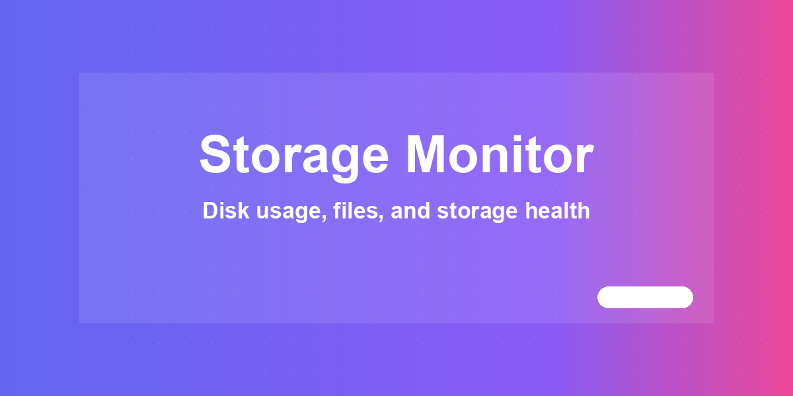
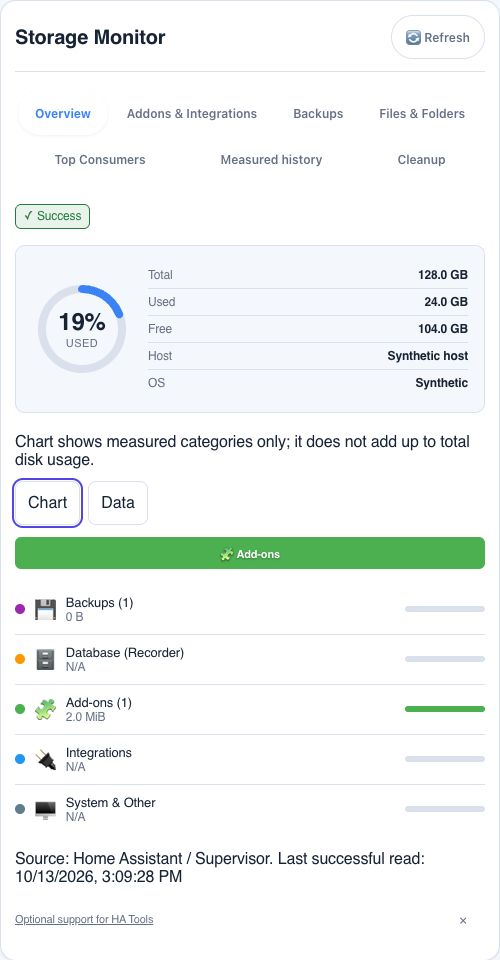
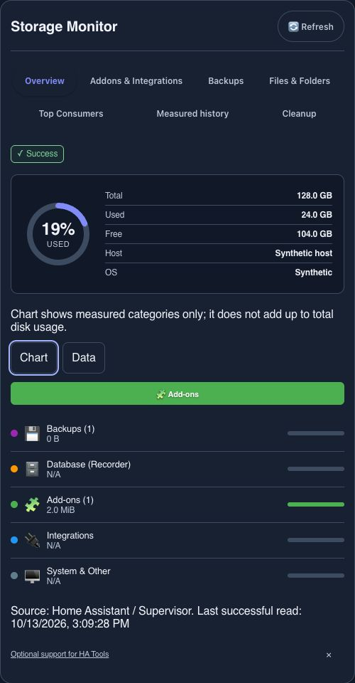
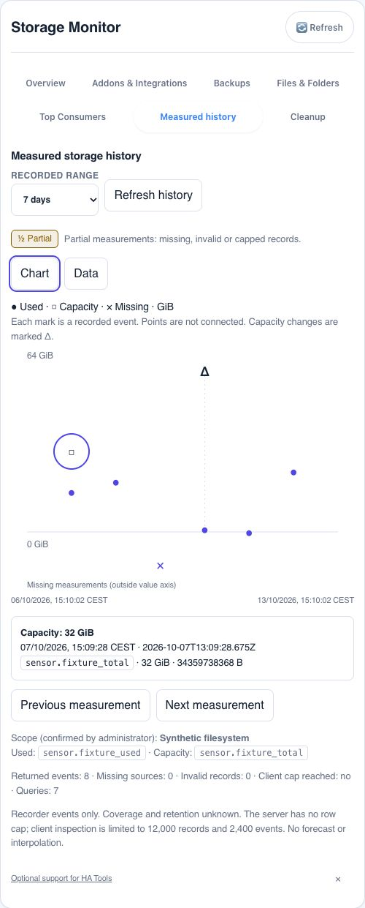
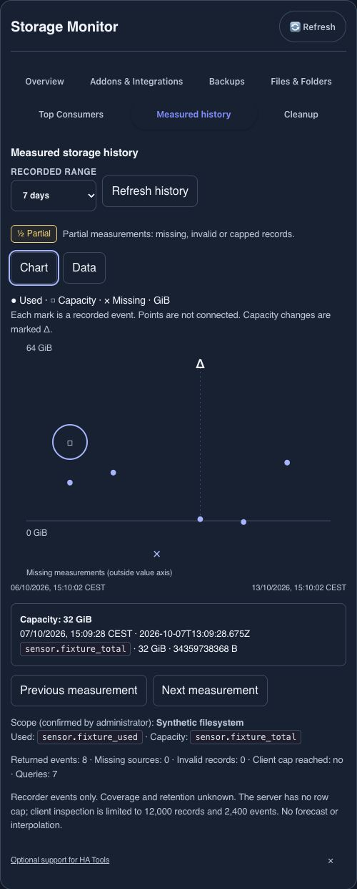

# Storage Monitor



Inspect Home Assistant host disk usage and the storage sizes the Supervisor
actually exposes — backups and, on some installations, add-ons. Add the card to read Supervisor data directly. Optionally select existing
Recorder sensors to explore measured storage history for the last 7 or 30 days.

[](https://github.com/MacSiem/ha-storage-monitor/releases) [](LICENSE)

## How it works

**It reads automatically when you are an administrator and the installation
has the Supervisor.** The card needs no configuration:

1. **Disk gauge from Supervisor.** On load it calls the Supervisor API
   (`supervisor/api` → `/host/info`, `/os/info`) for total / used / free disk
   space, hostname and OS version. The usage ring is host-wide. The
   category chart includes measured sizes only and does not claim to
   account for all used disk space.
2. **Real sizes where the API provides them.** Backups get their actual size
   from `size_bytes` in `supervisor/api` → `/backups`. Add-ons get their actual size from
   `supervisor/api` → `/addons` plus a per-addon `/addons/{slug}/info` call
   (first 30 installed add-ons). Where a real size isn't available, the card
   shows `N/A` rather than inventing a value.
3. **Clear unavailable and estimated values.** The recorder database size is
   not exposed by the `recorder/info` WebSocket call in current Home
   Assistant, so the card shows `N/A` instead of inventing a value. The
   config/`www`/`.storage`/`media`/`share` values on the Files & Folders tab
   are `N/A`; this browser card cannot measure directory sizes, including
   `/backup` and `/addons`. Backup inventory can include remote locations.
   Integrations are counted via `config_entries/get`, without assigning
   imaginary byte sizes. Partial add-on and backup totals are labelled.

### What is automatic vs. manual

| Automatic | Manual (optional) |
|---|---|
| Disk gauge + category breakdown on load | Nothing required to start |
| Real backup and add-on sizes from Supervisor | Switching between five tabs and the explicit cleanup review action |
| Refresh after 2 minutes on the next HA update | Manual refresh (⟳ button) |
| Measured capacity and review prompts | Reviewing backup retention or stopped add-ons in HA |
| Current measurements and their read status | Selecting two recorded sensors and refreshing measured history |

## Screenshots

| Light | Dark |
|---|---|
|  |  |

| Recorded history, light | Recorded history, dark |
|---|---|
|  |  |

*Version 4.2.0 rendered in Chrome with synthetic Supervisor and Recorder data.
The history example includes a missing measurement, a measured zero, a capacity
change and distinct GB/GiB units. These historical screenshots retain the old N/A category labels and seven-tab layout.
They do not show the variants, five-tab navigation or the current Not measured labels.*

## Installation

Requires Home Assistant 2025.2 or newer. Storage measurements require an
administrator account on Home Assistant OS / Supervised for Supervisor measurements.
Core / Container installations can show current capacity from an explicitly selected
used/capacity sensor pair. Supervisor categories remain unavailable for that filesystem.
Measured history also requires Recorder and History to be enabled.

1. Open HACS and search for **Storage Monitor** (category **Dashboard**).
2. Download the card and reload your browser.
3. Add a card of type `custom:ha-storage-monitor`. In YAML mode, register
   `/hacsfiles/ha-storage-monitor/ha-storage-monitor.js` as a module resource.
   Keep exactly one Storage Monitor resource; remove an older manual duplicate.

## Quick start

```yaml
type: custom:ha-storage-monitor
```

No options are required for current Supervisor measurements.

### Optional filesystem sensors and measured history

Open the card's visual editor and select **Used sensor** and **Capacity sensor**.
Both must already exist and have the `data_size` device class. Recorder must
record them to show measured history. Give the filesystem a clear name and confirm that both sources measure
the same filesystem. The card never guesses this relationship or creates sensors.
Changing either source or the scope clears that confirmation until you review it.

For example, replace these IDs with your own existing sensors:

```yaml
type: custom:ha-storage-monitor
measured_history:
  used_entity: sensor.disk_used
  total_entity: sensor.disk_capacity
  scope: Home Assistant data filesystem
  same_filesystem: true
```

The same confirmed pair supplies current capacity in **Overview** directly from HA
states, including on Core / Container. This explicitly selects that filesystem:
unavailable or invalid values show no data and never fall back to the Supervisor host.
Current capacity does not require a history refresh or Recorder. Values are normalized
to decimal GB; **Free (calculated)** is capacity minus used space. Source IDs, scope
and source timestamps are shown. Supervisor categories are unavailable for this scope;
the card does not attribute disk usage to backups or add-ons on another filesystem.
The administrator requirement remains. Without a selected pair, the default is Supervisor.

In **Measured history**, choose 7 or 30 days and select **Refresh history**.
The range ends at the time of the request. Select a plotted point, use the
previous/next buttons or switch to **Data** to inspect the same recorded event.
Dates follow Home Assistant profile preferences, including its display time zone; details also include UTC, the source
entity, original value and unit, and exact bytes. The plot uses GiB for both space
measurements. Decimal units such as GB and binary units such as GiB are converted
separately.

A cross marks a missing value outside the value axis; zero remains a measured
zero. Capacity changes have a Δ marker. Grey intervals indicate unknown continuity.
Recorder events are not connected or interpolated; a recorded state does not prove
continuous measurement. The card makes no fill-date forecast. Recorder coverage and retention remain unknown:
a successful read does not prove a complete 7- or 30-day history. Requests are
split into daily intervals; client inspection stops at 12,000 records or 2,400
events and labels the result partial. Data pages show 50 events at a time.

### Refresh results

The result remains visible after refreshing. **Success** means the supported
Supervisor sources were read; unsupported size measurements remain unavailable.
For history and the small variants, **Partial** also makes unknown measurement
coverage explicit even after a successful request. **No data** means no measurements
were returned or Supervisor is unavailable. **Error** reports a failed read without
showing private server details. **Not checked** is shown while a read is pending.
After a connection or account change, refresh explicitly to obtain a current
result. Cleanup suggestions are advisory and never delete backups or files.

### Optional sidebar panel (`configuration.yaml`)

```yaml
panel_custom:
  - name: ha-storage-monitor
    sidebar_title: Storage Monitor
    sidebar_icon: mdi:harddisk
    url_path: ha-storage-monitor
    js_url: /local/community/ha-storage-monitor/ha-storage-monitor.js
    embed_iframe: false
    config: {}
```

After restart, **Storage Monitor** appears in the HA sidebar.

## Features

- **Overview** — host disk usage ring, measured category chart and per-category
  size/`Not measured` list (Backups, Database, Add-ons, Integrations, System & Other).
- **Add-ons & Integrations** — every installed add-on with available measured
  size/status/version, and config entries with their setup source and status. Setup source
  does not identify Core versus HACS provenance; storage remains N/A.
- **Backups** — each backup with measured `size_bytes` when available, date
  and type from Supervisor.
- **Resources and folders**: known paths with `N/A` because this card does not
  measure directories: `/config`, `/config/www`,
  `/config/custom_components`, `/config/.storage`, `/backup`, `/addons`,
  `/ssl`, `/media`, `/share`, sortable by size or name.
  Its **Largest measured resources** disclosure contains the former Top Consumers
  ranking of up to 10 positive measured items. Supervisor categories are a separate
  scope and do not form a complete breakdown of the selected filesystem.
- **Measured history** — recorded used space and capacity over 7 or 30 days,
  interactive Chart/Data views, exact source details and marked gaps/capacity changes.
- **Review cleanup options** is an explicit action above the tabs. It opens measured
  capacity warnings and prompts to review backup retention or stopped add-ons.
  The suggestions do not delete anything. Saved `cleanup` navigation never opens
  the action automatically.

## FAQ

**Do I have to configure anything?**
Current Supervisor measurements need no configuration. Optionally select two existing sensors for the same filesystem in the visual editor to use that filesystem for current capacity; Recorder enables measured history for those sensors.

**Why does it say "Requires Home Assistant OS / Supervised"?**
Without a selected sensor pair, the card needs the Supervisor API (`supervisor/api`)
for current disk, add-on and backup data. This is only available on Home Assistant OS or Home Assistant
Supervised installations — Home Assistant Container/Core setups don't expose
it. The Supervisor views show this notice; Measured history remains available
with configured Recorder sources.

**Are the sizes exact?**
Backup and add-on sizes come from the Supervisor API when it provides an
unambiguous measurement. Missing values show `N/A`, and incomplete totals
are labelled partial. The recorder
database size is shown as `N/A` because Home Assistant's current
`recorder/info` response does not expose it. The Files & Folders tab is a
path inventory, not a filesystem scan; host disk usage cannot be allocated
to these categories reliably from the available API data.

**Does this send data anywhere?**
No. Everything runs locally in your browser against your own Home Assistant
instance — no telemetry, no analytics, no CDN-hosted assets. The only
outbound links are the optional Buy Me a Coffee / PayPal buttons and GitHub
install links, which only open if you click them.

## Variants, history and comparison

| Setting | Values | Behavior |
|---|---|---|
| `variant` | `tile`, `compact`, `full` | Missing or unrecognized values render Full. The card picker creates Compact. |
| `default_tab` | `overview`, `addons`, `backups`, `files`, `trend` | An explicit value selects the initial Full tab. Otherwise the saved tab or Overview is used. |
| Legacy `top` | Saved key or `default_tab` | Opens Resources and folders with the measured ranking expanded. |
| Legacy `cleanup` | Saved key or `default_tab` | Opens Overview with a notice about the cleanup review action. It performs no cleanup. |

`default_tab` applies when a card is created or that setting changes. Title edits
preserve current navigation. Reading a saved tab performs no migration write.
Navigation writes preserve unrelated saved fields.

Tile uses six section columns and one row. Compact has a small capacity summary
and at most two actions: Open full view and Refresh. Both share the selected
filesystem, snapshot, original source times and administrator policy with Full.
An invalid or unavailable pair never falls back to another disk.

Open full view uses the product-owned `ha-storage-monitor-full-view` element.
It receives current `hass`, shares the current snapshot and returns focus when
closed. Account, authority, instance, connection or online-session changes close
the view and invalidate pending history. Opening Full does not request Recorder
automatically. No variant creates sensors or changes dashboards.

Example for a new card, using existing sensors:

```yaml
type: custom:ha-storage-monitor
variant: compact
default_tab: trend
measured_history:
  used_entity: sensor.disk_used
  total_entity: sensor.disk_capacity
  scope: Home Assistant data filesystem
  same_filesystem: true
```

### What the measured change means

The 7/30-day selector defines the requested window ending at request time. The
delta uses the latest comparable sequence in the returned records, with at least
three pairs. Each pair requires used and capacity at exactly the same Recorder
timestamp. The confirmed filesystem and scope, source IDs and metadata, per-source
units, capacity and chronological order must remain comparable.

An old capacity is not carried forward to pair asynchronous used measurements.
Unknown, unavailable, changed capacity/source/units and conflicting timestamps
split the sequence. Attribute-only updates marked by an older `lc` are not counted
as new measurements. Incorrect input time order or malformed records suppress
comparison. GB and GiB remain distinct and are converted to bytes. A measured
zero change is possible; missing data is never a zero change.

The delta is last used bytes minus first used bytes. Actual endpoint dates, raw
bytes and the count of pairs remain available. The UI always labels this as an
available fragment, not a complete measurement of seven or thirty days.
The delta describes endpoint values, not continuity or a fill-date forecast.

### Why grey intervals can remain instead of steps

The existing `history/history_during_period` contract returns state updates.
Its `lu` is `last_updated`; it does not certify continuous physical sampling.
Even repeated equal values do not prove interval coverage. The adapter therefore
returns real points and unknown intervals, including before the first and after
the last point. No arbitrary gap duration or 100% coverage is assumed.

The segmented step renderer accepts explicitly confirmed measurement intervals,
but this Recorder adapter never manufactures that evidence. A producer with a
documented interval validity and filesystem identity contract is required before
continuous steps can be enabled. There is no YAML override pretending to provide
that evidence.

Sources: [Home Assistant state object](https://www.home-assistant.io/docs/configuration/state_object/),
[history WebSocket implementation](https://github.com/home-assistant/core/blob/dev/homeassistant/components/history/websocket_api.py)
and [state_reported announcement](https://developers.home-assistant.io/blog/2024/03/20/state_reported_timestamp/).
These explain source semantics and do not constitute native QA.

### Kategorie, warianty i historia po polsku

Kategorie z nieznanym rozmiarem mają opis „Nie zmierzono”. Przy mniej niż dwóch
dodatnich zmierzonych kategoriach widoczna jest lista danych. Zero i nieznane
kategorie pozostają widoczne. Inwentarz obliczony z bajtów używa MiB lub GiB.
Bieżąca pojemność pozostaje w dziesiętnych GB.

Stary YAML bez `variant` zachowuje Full. Nowy picker daje Compact. Tile i Compact
pokazują wybrany dysk, zajętość, wolne miejsce i jakość źródła. Wolne obliczone
z pary encji nie jest trzecim pomiarem. Kategorie Supervisor mają inny zakres
i nie tworzą pełnego bilansu tego filesystemu. Błędna para nie przełącza dysku.

Zakładki to Przegląd, Dodatki i integracje, Kopie zapasowe, Zasoby i katalogi
oraz Zmierzona historia. Zapisane `top` rozwija ranking zasobów. Zapisane `cleanup`
pokazuje Przegląd i informację o jawnej akcji porządkowania. Odczyt zakładki nie
uruchamia tej akcji. Select zastępuje zakładki wyłącznie przy zmierzonej dostępnej
szerokości poniżej 280 px.

Zmiana w zakresie 7 lub 30 dni wymaga co najmniej trzech porównywalnych par użycia
i pojemności o dokładnie zgodnych czasach. Obowiązują ten sam potwierdzony
filesystem, zakres, źródła, metadane, jednostki, pojemność i kolejność czasu.
Starej pojemności nie przypisujemy nowemu użyciu. Unknown, unavailable i zmiany
źródeł dzielą sekwencję. Widoczne są faktyczne daty, liczba par i surowe bajty.
Dostępny fragment nie jest pełnym pomiarem 7 lub 30 dni; brak danych nie jest zerem.

Recorder nie potwierdza pomiarów między zapisami. Szare odcinki pozostają nieznane,
a punkty nie są łączone bez potwierdzenia ciągłości. Nie ma arbitralnego progu
luki, interpolacji, ekstrapolacji, procentu kompletności ani prognozy zapełnienia.
Aktualizacje samych atrybutów z jawnym starszym `lc` nie liczą się jako nowe pomiary.
Szczegóły zachowują UTC i strefę. Zwykły widok używa krótkich lokalnych dat i godzin
zgodnych z profilem Home Assistant.

## Changelog

See [CHANGELOG.md](CHANGELOG.md).

## Support

If this tool makes your Home Assistant life easier, consider supporting
development:

- [☕ Buy Me a Coffee](https://buymeacoffee.com/macsiem)
- [💳 PayPal](https://www.paypal.com/donate/?hosted_button_id=Y967H4PLRBN8W)

The optional in-card support link is shown only to administrators. Dismiss it in the card or set `show_support: false` in the card configuration.

## License

MIT, see [LICENSE](LICENSE).

## Privacy and data

The card reads available Home Assistant and Supervisor storage information and, when configured, Recorder history for the two selected sensors. Host details, integration lists and backup metadata can identify your installation. Keep diagnostics private and redact host names, paths and identifiers before sharing.

See [SECURITY.md](SECURITY.md) for safe vulnerability reporting and [NOTICE](NOTICE) for licensing notices.
